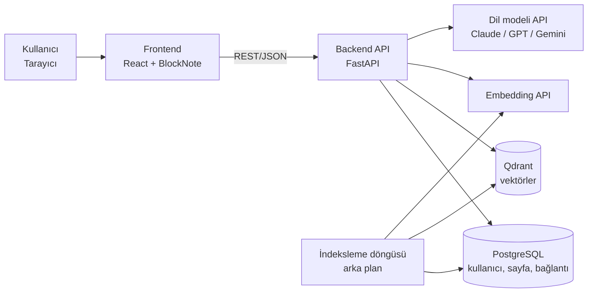

# 🐝 Kovan

**Notion benzeri kişisel bilgi tabanı + anlamsal arama + kaynak gösteren yapay zeka sohbeti (RAG).**

**Sarı Takım** · Yapay Zeka Destekli Yazılım Geliştirme dersi dönem projesi · Proje kodu **P0007 – Bilgi Tabanı (Notion Clone + Anlamsal Arama)** · Teslim: **25 Aralık 2026**

[](https://github.com/semihbekdas/sari-takim-kovan/actions/workflows/ci.yml)
[](https://sonarcloud.io/summary/new_code?id=semihbekdas_sari-takim-kovan)

> **Durum:** 🛠️ Geliştirme, Sprint 1 (backend iskeleti, CI ve SonarQube Cloud). Bu README her sprint sonunda güncellenir; henüz uygulanmamış bölümler *(planlanan)* olarak işaretlidir.

> **Buradan başlayın:** 1) Bu README'nin 1–4. bölümleri (ne, neden, mimari) → 2) [docs/architecture.md](docs/architecture.md) § 4–5 (katmanlar ve ana akışlar) → 3) Kod: `backend/src/kovan/main.py` → `api/errors.py` → `backend/tests/acceptance/`. Güncel durum ve sprint planı: [docs/PLAN.md](docs/PLAN.md) § 4 ve § 7.
>
> **Okuma notu:** «§ N» bulunduğunuz dokümanın N. bölümüdür; «ders Bölüm N» ise [ders reposundaki](https://github.com/buraksenyurt/ai-based-development-lecture) `chapter-NN.md` dosyasıdır. Kısaltmalar: **İP-A/B/C** iş paketleri (Umut, Özlem, Semih; [PLAN](docs/PLAN.md) § 3) · **F-xx** özellik · **US-xx** kullanıcı hikayesi · **AC-xx.y** kabul kriteri · **R-xx** domain kuralı · **Must/Should/Could** öncelik (MoSCoW: olmazsa olmaz / olmalı / zaman kalırsa).

---

## İçindekiler

1. [Proje Amacı](#1-proje-amacı)
2. [Neden "Kovan"?](#2-neden-kovan)
3. [Özellikler](#3-özellikler)
4. [Mimari Tasarım](#4-mimari-tasarım)
5. [Teknolojiler](#5-teknolojiler)
6. [Veritabanı](#6-veritabanı)
7. [Kullanılan Yapay Zeka Araçları](#7-kullanılan-yapay-zeka-araçları)
8. [Kurulum ve Çalıştırma](#8-kurulum-ve-çalıştırma)
9. [Testler](#9-testler)
10. [Kod Kalitesi ve Güvenlik](#10-kod-kalitesi-ve-güvenlik)
11. [Karşılaşılan Zorluklar ve Çözümler](#11-karşılaşılan-zorluklar-ve-çözümler)
12. [Ders Kriterlerinin Karşılanması](#12-ders-kriterlerinin-karşılanması)
13. [Proje Yönetimi ve Ekip](#13-proje-yönetimi-ve-ekip)
14. [Doküman Haritası](#14-doküman-haritası)

---

## 1. Proje Amacı

İnsanlar not alır ama aradıklarını bulamaz: Kelime birebir geçmiyorsa klasik arama işe yaramaz. **Kovan**, Notion tarzı blok editörüyle yazılan sayfaları arka planda **embedding** ile vektörlere çevirir, **Qdrant** vektör veritabanında indeksler ve kullanıcının sorularını **sadece kendi notlarına dayanarak** ve **kaynak sayfayı göstererek** cevaplar. Notlarda cevap yoksa uydurmaz.

Asıl amaç yalnızca bir Notion klonu yazmak değil; bunu ders boyunca işlenen ilkelere uygun biçimde yapmak: **katmanlı mimari, test edilebilirlik, düşük teknik borç, güvenlik ve "Agentic Engineering"**.

## 2. Neden "Kovan"?

Arılar binlerce çiçekten topladıklarını kovanda **düzenli peteklere** yerleştirir; Kovan da dağınık notları düzenli **sayfalara** toplar. Kovandaki **işçi arılar** gibi, Kovan'da da arka planda çalışan bir **indeksleme işçisi** sayfaları yapay zekanın anlayacağı hale getirir. Kısa, Türkçe, akılda kalıcı ve başka bir ürünün marka adını kullanmıyor.

## 3. Özellikler

Tam liste ve öncelikler: **[OZELLIKLER.md](OZELLIKLER.md)**

- 🔐 Kayıt / giriş; her kullanıcı yalnızca kendi verisini görür
- 📝 Blok tabanlı editör (BlockNote), otomatik kaydetme, çakışma koruması
- 🌳 Alt sayfalar, sayfa ağacı, breadcrumb, silme (*Should:* çöp kutusu, taşıma)
- 🔗 Sayfalar arası bağlantı ve geri bağlantılar
- 🔎 Kelime araması + **anlamsal arama**
- 🤖 **"Sayfalarına Sor"**: kaynak gösteren RAG sohbeti
- ⚙️ Arka planda, hataya dayanıklı ve maliyet dostu indeksleme
- 🧩 *(Should)* Token kullanım raporu, sohbet geçmişi, MCP Server

## 4. Mimari Tasarım

Ayrıntı: **[docs/architecture.md](docs/architecture.md)** · Neden bu mimari: **[docs/mimari-secimi.md](docs/mimari-secimi.md)** · Kararlar: **[docs/adr/](docs/adr/)**

**Mimari: Katmanlı mimari + port/adapter (Clean Architecture'ın bağımlılık kuralı), modüler monolit.**



```
api ──► application ──► domain
             ▲
infrastructure (PostgreSQL, Qdrant, yapay zeka API'leri, güvenlik, indeksleme)
```

**Neden?** 3 kişilik ekip ve ~4 haftalık süre için Richards & Ford karşılaştırmasında **basitlik ve maliyette** en iyi seçenek katmanlı yapıdır; mikroservis veya event-driven bir yapı bu ölçekte "gereksiz karmaşıklık borcu" olurdu (ders Bölüm 7–8). Katmanlı yapının zayıf yanı olan test edilebilirliği **port/adapter arayüzleriyle** güçlendiriyoruz; bu, hocanın ProjectRouter örneğindeki yapının aynısıdır. Katman kuralları **import-linter** ile CI'da otomatik denetlenir. 8 mimari stil ve 6 kod organizasyonu yaklaşımının karşılaştırması [mimari-secimi.md](docs/mimari-secimi.md)'de.

## 5. Teknolojiler

| Alan | Teknoloji | Neden (ADR) |
| --- | --- | --- |
| Backend | Python 3.12, FastAPI | [ADR-002](docs/adr/ADR-002-python-fastapi.md) |
| İlişkisel veritabanı | PostgreSQL (sayfa içeriği JSONB) | [ADR-003](docs/adr/ADR-003-postgresql.md) |
| Veri erişimi | SQLAlchemy 2.x Core + Alembic | [ADR-003](docs/adr/ADR-003-postgresql.md) |
| Vektör veritabanı | Qdrant | [ADR-004](docs/adr/ADR-004-qdrant.md) |
| İndeksleme | Sürüm işaretli arka plan döngüsü | [ADR-005](docs/adr/ADR-005-surum-isaretli-indeksleme.md) |
| Yapay zeka | Bulut dil modeli (Claude / GPT / Gemini) + embedding API; fake mod | [ADR-006](docs/adr/ADR-006-llm-saglayici.md) |
| Frontend | React + TypeScript + Vite, BlockNote | [ADR-007](docs/adr/ADR-007-frontend-blocknote.md) |
| Kimlik doğrulama | JWT (httpOnly çerez) + Argon2id | [ADR-008](docs/adr/ADR-008-kimlik-dogrulama.md) |
| Parçalama | Başlık farkındalıklı chunking | [ADR-009](docs/adr/ADR-009-chunking.md) |
| Test ve kalite | pytest, Testcontainers, Vitest, ruff, mypy, import-linter, SonarQube Cloud | [ADR-010](docs/adr/ADR-010-test-ve-kalite.md) |
| Altyapı | Docker Compose, GitHub Actions | — |

## 6. Veritabanı

Ders şartı: *en az bir veritabanı.* Kovan **iki** veritabanı kullanır:

| Veritabanı | Ne tutar |
| --- | --- |
| **PostgreSQL** | `users`, `pages` (içerik JSONB, düz metin, indeks durumu), `page_links`; *(Should)* `chat_sessions`, `chat_messages` |
| **Qdrant** | Sayfa parçalarının vektörleri + `owner_id`, `page_id`, başlık yolu gibi meta veriler |

Şema ve kurallar: [docs/domain-design.md](docs/domain-design.md)

## 7. Kullanılan Yapay Zeka Araçları

Ders şartı: *"Kullanım şekli proje dokümantasyonunda açıkça belirtilmelidir."* Kovan'da yapay zeka **iki şekilde** kullanılır.

### 7.1 Ürünün içinde (entegrasyon)

| Bileşen | Kullanım |
| --- | --- |
| Embedding API (OpenAI / bge-m3 / Voyage; ekip ölçerek seçecek, ADR-006) | Sayfa parçalarını ve kullanıcı sorusunu vektöre çevirir |
| Qdrant | Kosinüs benzerliği ile anlamsal arama (ders Bölüm 9–10) |
| Dil modeli API (Claude / GPT / Gemini; ekip seçecek) | Getirilen parçalardan **kaynaklı** cevap üretir (RAG) |
| *(Should)* MCP Server | Yapay zeka asistanlarının Kovan'da salt-okunur arama yapması (ders Bölüm 12–13) |

- **Fake mod:** API anahtarı olmadan uygulama ve testler sahte (deterministik) yapay zeka ile çalışır. Güçlü bilgisayar veya yerel model gerekmez.
- **Gizlilik:** Gerçek modda soru ve ilgili not parçaları seçilen bulut sağlayıcıya gönderilir. Demo ve değerlendirme verileri kurgusaldır.
- Sağlayıcı seçenekleri, fiyatlar ve maliyet tahmini: [ADR-006](docs/adr/ADR-006-llm-saglayici.md). *(Seçilen sağlayıcı ve ölçülen token kullanımı buraya eklenecek.)*

### 7.2 Geliştirme sürecinde (araç olarak)

| Araç | Kullanım |
| --- | --- |
| Claude Code | Doküman taslakları, kod ve test üretimi, refactoring, review desteği |
| Codex / GitHub Copilot | Kod üretimi ve editör içi tamamlama |
| `AGENTS.md` / `CLAUDE.md` | Ajanların uyması gereken mimari, kod ve test kuralları |

**Agentic Engineering yaklaşımı:** Yapay zekanın ürettiği her çıktı, commit'i atan kişi tarafından okunur, test edilir ve gerekirse düzeltilir. Önemli prompt'lar, yapay zekanın hataları ve düzeltmelerimiz **[docs/ai-log.md](docs/ai-log.md)** dosyasındadır.

## 8. Kurulum ve Çalıştırma

> Backend iskeleti hazır. `docker compose`, Alembic ve frontend adımları ilgili işler bitince geçerli olacak *(planlanan)*.

**Gereksinimler:** Python 3.12 + [uv](https://docs.astral.sh/uv/) (backend) · Docker (entegrasyon testleri; `docker compose` gelince PostgreSQL ve Qdrant da Docker'da çalışır) · Node.js 22 LTS (frontend gelince). Yerel yapay zeka modeli **gerekmez**.

```bash
git clone https://github.com/semihbekdas/sari-takim-kovan.git && cd sari-takim-kovan
cp .env.example .env                 # varsayılan: fake yapay zeka modu (anahtarsız)
docker compose up -d                 # PostgreSQL + Qdrant (planlanan)

cd backend
uv sync                              # Python 3.12 yoksa uv kendisi indirir
uv run alembic upgrade head          # (planlanan)
uv run uvicorn kovan.main:create_app --factory --reload
# API: http://localhost:8000/api/v1/health · Swagger: http://localhost:8000/api/docs
# /api/v1/health/ready, veritabanına ulaşamazsa 503 döner (docker compose gelince 200)

cd ../frontend                       # (planlanan)
npm install
npm run dev                          # http://localhost:5173
```

Gerçek yapay zeka için `.env` içinde `CHAT_PROVIDER`, `EMBEDDING_PROVIDER`, model adları ve API anahtarları doldurulur ([architecture.md § 8](docs/architecture.md#8-yapılandırma)). **`.env` asla commit'lenmez.**

## 9. Testler

Strateji: **[docs/test-strategy.md](docs/test-strategy.md)** · Hikayeler ve kabul kriterleri: **[docs/user-stories.md](docs/user-stories.md)**

| Tür | Araç | Kapsam |
| --- | --- | --- |
| Birim | pytest, Vitest | Domain kuralları, servisler, chunking, prompt oluşturma, UI mantığı |
| Entegrasyon | pytest + Testcontainers | PostgreSQL repository'leri, Qdrant adaptörü, indeksleme döngüsü |
| Kabul | pytest (API senaryoları) | Her Must kabul kriteri (AC) en az bir teste bağlı |
| Uçtan uca *(Should)* | Playwright | 3 duman senaryosu |
| RAG değerlendirme | Kendi değerlendirme setimiz | Hit@5 (doğru sayfa ilk 5 sonuçta mı), MRR (doğru sayfa ortalama kaçıncı sırada) |

```bash
cd backend
uv run pytest --cov                    # testler + kapsam (Docker kapalıysa entegrasyon testleri yerelde atlanır, CI'da zorunlu)
uv run ruff check . && uv run ruff format --check .   # lint + biçim
uv run mypy                            # tip kontrolü (strict)
uv run lint-imports                    # mimari katman kuralları

cd ../frontend && npm test             # (planlanan)
```

*Sonuçlar (test sayısı, kapsam, RAG metrikleri) sprintler ilerledikçe buraya eklenecek.*

## 10. Kod Kalitesi ve Güvenlik

- **SonarQube Cloud:** Her PR'da CI'dan analiz edilir ([proje sayfası](https://sonarcloud.io/summary/new_code?id=semihbekdas_sari-takim-kovan)). Hedef güvenilirlik, güvenlik ve bakım kolaylığında **A**. *(Rapor ekran görüntüsü buraya eklenecek.)*
- **CI (GitHub Actions):** Her PR'da lint, biçim, tip kontrolü, mimari kurallar, testler ve kapsam ([`.github/workflows/ci.yml`](.github/workflows/ci.yml)).
- **ruff, mypy:** CI'da zorunlu; **eslint** frontend iskeleti gelince eklenecek *(planlanan)*.
- **import-linter:** Mimari katman kuralları CI'da zorunlu.
- **Güvenlik önlemleri:** Argon2id şifre hash, httpOnly çerez, her sorguda `owner_id` filtresi, parametreli SQL, kullanıcı içeriğinin HTML olarak basılmaması, prompt injection'a karşı içeriğin modele "veri" olarak verilmesi, API anahtarlarının yalnızca `.env`'de tutulması ve GitHub push protection. Tehdit modeli: [architecture.md § 9](docs/architecture.md#9-güvenlik).

## 11. Karşılaşılan Zorluklar ve Çözümler

> Proje boyunca doldurulacak. Kaynak: [docs/ai-log.md](docs/ai-log.md) ve sprint değerlendirmeleri.

| # | Zorluk | Çözüm | İlgili |
| --- | --- | --- | --- |
| 1 | PostgreSQL ile Qdrant arasında tutarlılık: Sayfa silinince vektörü kalabiliyor, her otomatik kayıtta embedding çağırmak pahalı | Sürüm işaretli indeksleme: düzenleme bitince tek seferlik, yeniden denemeli ve idempotent işleme; aramada PostgreSQL doğrulaması | ADR-005 |
| 2 | Claude'un embedding modeli yok | Sohbet ve embedding sağlayıcıları ayrı port'lar; embedding için ayrı sağlayıcı | ADR-006 |
| 3 | İlk doküman taslağı aşırı mühendislik içeriyordu (ayrı iş tablosu, ORM eşlemesi vb.) | Gözden geçirmede sadeleştirildi; gerekçeler ADR'lerde | ai-log |
| 4 | İlk SonarQube analizinde güvenlik derecesi **C** çıktı: CI'daki bağımlılık kurulumu paketlerin kurulum betiklerini çalıştırabiliyor ve kilitli sürümlerden sapabiliyordu | Kurulum `--locked --no-build`, komutlar `--frozen --no-sync` yapıldı; kalite kapısı **A** ile geçti | PR #1 |

## 12. Ders Kriterlerinin Karşılanması

Ders rehberindeki her değerlendirme kriteri ve projedeki karşılığı:

| Kriter (ders rehberi) | Projede nasıl karşılanıyor | Kanıt |
| --- | --- | --- |
| **Takım:** yakın ağırlıkta katkı | 3 dengeli dikey iş paketi, herkes kendi modülünün sahibi, haftalık `git shortlog` kontrolü | [PLAN.md](docs/PLAN.md), GitHub Insights |
| **Dil Modeli:** en az bir yapay zeka aracı, kullanımı belgelenmiş | Ürün içinde embedding + RAG (+ MCP); geliştirmede Claude Code / Codex / Copilot | § 7, [ai-log.md](docs/ai-log.md) |
| **Geliştirme Süreci:** GitHub, gerçekçi commit geçmişi, anlamlı mesajlar, ≥ 3 PR | Feature branch + PR + review, Conventional Commits, squash yok, haftalara yayılmış iş | [KURALLAR.md](KURALLAR.md), commit geçmişi |
| **Teknik Borç:** A kalite, ölçüm aracı | SonarQube Cloud her PR'da | § 10, Sonar raporu |
| **Güvenlik** | Kimlik doğrulama, yetkilendirme testleri, prompt injection önlemi, anahtar yönetimi | § 10, [architecture.md § 9](docs/architecture.md#9-güvenlik) |
| **Mimari Uyum** | Araştırılarak seçilmiş ve belgelenmiş mimari + ADR'ler; import-linter ile otomatik denetim | [mimari-secimi.md](docs/mimari-secimi.md), [architecture.md](docs/architecture.md) |
| **Okunabilirlik** | Kod kuralları, ruff/eslint, düşük karmaşıklık, review | [KURALLAR.md](KURALLAR.md) § 4 |
| **Test Edilebilirlik:** birim + entegrasyon | Port/adapter, birim + entegrasyon + kabul testleri, AC ↔ test izlenebilirliği | [test-strategy.md](docs/test-strategy.md) |
| **Dokümantasyon:** mimari, AI araçları, zorluklar | Bu README + `docs/` | Bu dosya |
| **Veritabanı** | PostgreSQL + Qdrant | § 6 |
| **Sunum:** ≤ 25 dk, koda hakimiyet | Herkes kendi iş paketini anlatır; review'lar sayesinde diğer modülleri de bilir; 2 prova | [PLAN.md](docs/PLAN.md) |

## 13. Proje Yönetimi ve Ekip

- Plan, sprintler, iş paketleri, riskler, skor kartı: **[docs/PLAN.md](docs/PLAN.md)**
- Ekip çalışma kuralları: **[KURALLAR.md](KURALLAR.md)**
- Takım: **Sarı Takım** · Repo: `sari-takim-kovan`
- Toplantılar: hafta sonu · Kod dondurma: 13 Aralık · Teslim: 25 Aralık

| Üye | İş paketi | Sorumluluk |
| --- | --- | --- |
| Umut | İP-A Sayfalar & Editör | docker-compose + frontend iskeleti; sayfa API'si, sayfa ağacı, editör, otomatik kaydetme, silme, `@` bağlantısı |
| Özlem | İP-B Kimlik, İçerik & Arama | Kayıt/giriş, içerik doğrulama, chunking, geri bağlantılar, kelime ve anlamsal arama |
| Semih | İP-C Yapay Zeka | Backend iskeleti, CI + SonarQube Cloud; yapay zeka adaptörleri, Qdrant, indeksleme, "Sayfalarına Sor" |
| Herkes | Ortak | Değerlendirme seti ve embedding karşılaştırması, güvenlik gözden geçirmesi, README, sunum |

## 14. Doküman Haritası

| Doküman | İçerik |
| --- | --- |
| [OZELLIKLER.md](OZELLIKLER.md) | Uygulama özellikleri (MoSCoW), ekranlar, kararlar |
| [KURALLAR.md](KURALLAR.md) | Git, commit, PR, kod, test, doküman, yapay zeka ve güvenlik kuralları |
| [AGENTS.md](AGENTS.md) / [CLAUDE.md](CLAUDE.md) | Yapay zeka ajanları için proje talimatları |
| [docs/PLAN.md](docs/PLAN.md) | Sprint planı, iş paketleri, riskler, skor kartı |
| [docs/mimari-secimi.md](docs/mimari-secimi.md) | Mimari araştırması ve seçim gerekçesi |
| [docs/architecture.md](docs/architecture.md) | Mimari tasarım, akışlar, güvenlik, yapılandırma |
| [docs/domain-design.md](docs/domain-design.md) | Entity'ler, alanlar, domain kuralları (R-01 … R-13), şema |
| [docs/api-contract.md](docs/api-contract.md) | REST API sözleşmesi |
| [docs/user-stories.md](docs/user-stories.md) | Kullanıcı hikayeleri ve kabul kriterleri (AC) |
| [docs/test-strategy.md](docs/test-strategy.md) | Test stratejisi, izlenebilirlik matrisi, RAG değerlendirmesi |
| [docs/adr/](docs/adr/) | Mimari karar kayıtları (ADR-001 … ADR-010) |
| [docs/ai-log.md](docs/ai-log.md) | Yapay zeka kullanım günlüğü |

---

*Ders materyali: [buraksenyurt/ai-based-development-lecture](https://github.com/buraksenyurt/ai-based-development-lecture)*
