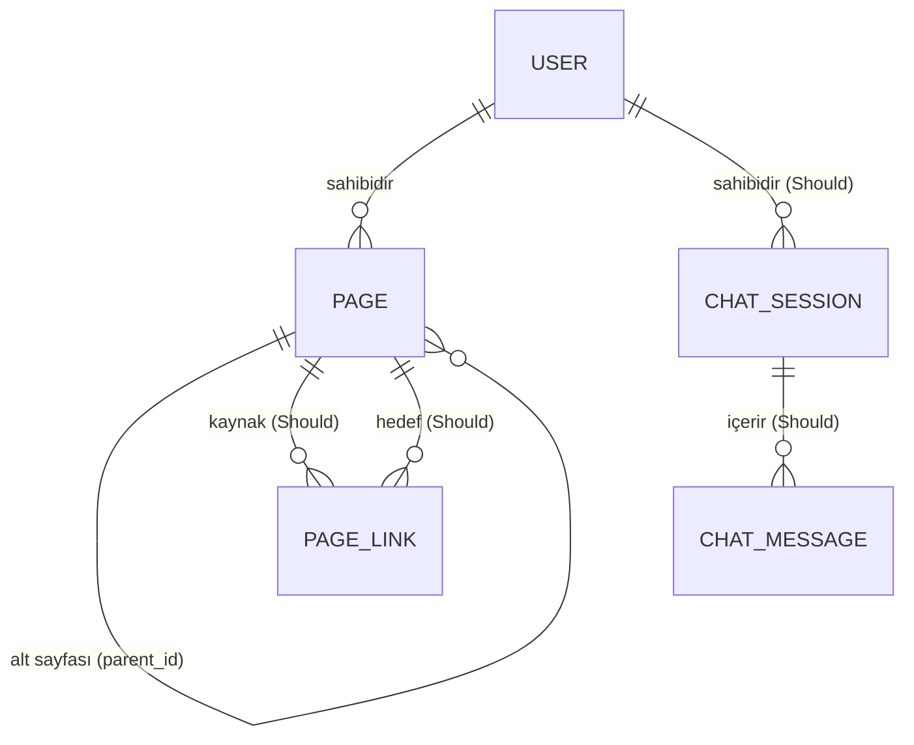

# Domain Tasarımı

> Kovan'daki varlıklar (entity), değer nesneleri (value object), alanları ve **domain kuralları**. Kural ihlalleri kodda `DomainRuleError(rule_code="R-xx")` ile bildirilir ve API hata yanıtındaki `rule` alanında döner (hocanın ProjectRouter örneğindeki `Rule 00` yaklaşımı gibi).

---

## 1. Genel bakış



| Kavram | Tür | Saklandığı yer |
| --- | --- | --- |
| User | Entity | PostgreSQL `users` |
| Page | **Aggregate root** (indeks durumu dahil) | PostgreSQL `pages` |
| PageContent | Value object | `pages.content` (JSONB) |
| PageLink | Entity *(Should)*, içerikten türetilir | PostgreSQL `page_links` |
| Chunk | Value object | Qdrant `page_chunks` |
| ChatSession / ChatMessage | Entity *(Should)* | PostgreSQL `chat_sessions`, `chat_messages` |
| Citation | Value object | Sohbet cevabı (Should: `chat_messages.citations`) |

Tüm kimlikler **UUID v4** (Qdrant nokta kimlikleri hariç, bkz. Chunk). Tüm zamanlar **UTC**.

---

## 2. User *(Entity)*

| Alan | Tür | Açıklama | Örnek | Kural |
| --- | --- | --- | --- | --- |
| `id` | UUID | Benzersiz kimlik | `3f1c…` | — |
| `email` | Text | Giriş e-postası, küçük harfe çevrilerek saklanır | `ayse@ornek.com` | R-01 |
| `display_name` | Text | Görünen ad | `Ayşe Y.` | 2–50 karakter |
| `password_hash` | Text | Argon2id hash | `$argon2id$v=19$…` | R-02; asla dışarı verilmez |
| `created_at` | Timestamp | Kayıt zamanı | — | — |

## 3. Page *(Aggregate Root)*

| Alan | Tür | Açıklama | Örnek | Kural |
| --- | --- | --- | --- | --- |
| `id` | UUID | Benzersiz kimlik | `9a2e…` | — |
| `owner_id` | UUID | Sahibi olan kullanıcı | `3f1c…` | Değiştirilemez |
| `parent_id` | UUID? | Üst sayfa; `null` ise kök sayfa | `null` | R-04, R-05 |
| `title` | Text | Sayfa başlığı | `Veritabanı` | R-03 |
| `content` | [PageContent](#4-pagecontent-value-object) | Blok içerik | `[{type:"heading",…}]` | R-06 |
| `plain_text` *(Should)* | Text | İçerikten türetilen düz metin; kelime araması (F-18) ile birlikte eklenir | `Normalizasyon …` | Sadece sistem yazar |
| `version` | Integer | İyimser kilitleme sürümü; içerik/görünürlük her değiştiğinde +1 | `7` | R-07, R-10 |
| `deleted_at` | Timestamp? | Silinme (çöpe atılma) zamanı | `null` | R-08 |
| `indexed_version` | Integer? | Qdrant'a en son işlenen sürüm | `7` | R-10 |
| `index_attempts` | Integer | Ardışık başarısız indeksleme denemesi | `0` | R-11 |
| `index_error` | Text? | Son indeksleme hatasının kısa özeti (hassas veri içermez) | `timeout` | R-11 |
| `index_retry_at` | Timestamp? | Bir sonraki deneme zamanı | `null` | R-11 |
| `created_at` / `updated_at` | Timestamp | — | — | — |

**Türetilen bilgiler (saklanmaz):**
- `index_status`: `INDEXED` (`indexed_version = version`), `FAILED` (`index_attempts ≥ 5`), aksi halde `PENDING`
- `breadcrumbs` (üst sayfa zinciri), `has_children`

Kardeş sayfalar **başlığa göre alfabetik** sıralanır; elle sıralama yoktur (Won't). Ç, Ğ, İ, Ö, Ş, Ü harflerinin Türkçe sırada olması için PostgreSQL'in ICU harmanlaması kullanılır (`ORDER BY title COLLATE "tr-x-icu"`).

## 4. PageContent *(Value Object)*

BlockNote editörünün ürettiği blok dizisi. Değişmezdir; doğrulama oluşturulurken yapılır (R-06).

| Kategori | İzin verilenler |
| --- | --- |
| **Blok türleri** | `paragraph`, `heading` (seviye 1–3), `bulletListItem`, `numberedListItem`, `checkListItem`, `codeBlock`, `quote` |
| **Satır içi içerik** | `text`, `link` (yalnızca `http`/`https`), `pageMention` (props: `pageId`) |
| **Stiller** | Kısıtlanmaz (kalın, italik, renk vb. zararsız biçim bilgileridir) |

> Frontend'deki BlockNote şeması **aynı blok listesiyle** yapılandırılır (ADR-007). Böylece kullanıcı editörde backend'in reddedeceği bir blok (tablo, görsel vb.) ekleyemez.

Davranışlar (saf fonksiyonlar, birim testli):
- `to_plain_text()` → düz metin (*Should:* kelime araması için `plain_text` sütununa yazılır)
- `mentioned_page_ids()` → içerikteki `pageMention` hedefleri (*Should:* PageLink üretimi)
- `to_sections()` → başlık hiyerarşisine göre bölümler (parçalama, ADR-009)

> **Not:** `to_sections()` parçalama (ADR-009) tarafından kullanılır ve onunla birlikte yazılır.

## 5. PageLink *(Entity — Should)*

Geri bağlantılar (F-16) yapılırsa eklenir. `@` bağlantısının kendisi (F-15) bu tabloya ihtiyaç duymaz: Hedef sayfanın kimliği içerikteki `pageMention`'da durur.

Sayfalar arası bağlantı. **Elle oluşturulmaz**; sayfa her kaydedildiğinde içerikteki `pageMention`'lardan yeniden türetilir (R-09).

| Alan | Tür | Açıklama |
| --- | --- | --- |
| `source_page_id` | UUID | Bağlantıyı içeren sayfa |
| `target_page_id` | UUID | Bağlantı verilen sayfa |
| `owner_id` | UUID | İkisinin ortak sahibi |

Birincil anahtar: `(source_page_id, target_page_id)`.

## 6. Chunk *(Value Object — Qdrant noktası)*

| Alan | Tür | Açıklama |
| --- | --- | --- |
| `point_id` | UUID v5 | `uuid5(NAMESPACE, f"{page_id}:{chunk_no}")`; deterministik, idempotent yazma sağlar |
| `vector` | float[`EMBEDDING_DIM`] | Embedding |
| `payload.owner_id` | UUID (indeksli) | **Her aramada zorunlu filtre** (R-12) |
| `payload.page_id` | UUID (indeksli) | Sayfa bazlı silme ve gruplama |
| `payload.page_title` | Text | Sonuç gösterimi |
| `payload.heading_path` | Text | `Veritabanı › Normalizasyon › 3NF` |
| `payload.chunk_no` | Integer | Sayfa içindeki sıra |
| `payload.text` | Text | Parçanın metni (bağlam ve özet için) |
| `payload.page_version` | Integer | Hangi sayfa sürümünden üretildiği |

## 7. ChatSession / ChatMessage *(Entity — Should)*

Must aşamasında sohbet **durumsuzdur** (her soru bağımsız). Sohbet geçmişi Should'dur.

| ChatSession | Tür | Açıklama |
| --- | --- | --- |
| `id`, `owner_id` | UUID | — |
| `title` | Text | İlk sorudan türetilir (≤ 80 karakter) |
| `created_at` | Timestamp | — |

| ChatMessage | Tür | Açıklama |
| --- | --- | --- |
| `id`, `session_id` | UUID | — |
| `role` | `USER` / `ASSISTANT` | — |
| `content` | Text | Soru veya cevap |
| `citations` | Citation[] (JSONB) | `{index, page_id, page_title, heading_path}` |
| `created_at` | Timestamp | — |

---

## 8. Domain kuralları

| Kod | Kural | Nerede | İhlalde | Öncelik |
| --- | --- | --- | --- | --- |
| **R-01** | E-posta geçerli formatta ve büyük/küçük harf duyarsız olarak **benzersiz**dir. | `User`, DB unique index | 422 / 409 | Must |
| **R-02** | Şifre 8–128 karakterdir; yalnızca Argon2id hash'i saklanır. | `AuthService` | 422 | Must |
| **R-03** | Başlık kırpıldıktan sonra en fazla 200 karakterdir; boşsa **"Adsız"** olur. | `Page` | 422 | Must |
| **R-04** | Üst sayfa aynı kullanıcıya ait olmalı ve silinmiş olmamalıdır. | `PageService` | 404 | Must |
| **R-05** | Hiyerarşide **döngü olamaz**: Bir sayfa kendi altına veya alt sayfalarından birinin altına taşınamaz. | `PageService.move` | 422 | Should (taşıma ile) |
| **R-06** | İçerik yalnızca izin verilen blok ve satır içi türleri içerir; JSON boyutu ≤ **512 KB**; bloklar en fazla **20** kat iç içe olabilir. | `PageContent` | 422 | Must |
| **R-07** | Güncelleme, istemcinin gönderdiği `version` güncel sürüme eşitse yapılır (iyimser kilitleme). | `Page.update` | 409 | Must |
| **R-08** | Silinen sayfa **alt sayfalarıyla birlikte** silinmiş işaretlenir; ağaçta, aramada ve sohbette görünmez. (Should: geri bağlantılarda da görünmez; çöp kutusundan geri alınınca hepsi geri gelir.) | `PageService.delete/restore` | — | Must |
| **R-09** | Bağlantılar içerikten türetilir; yalnızca aynı kullanıcının sayfalarına verilebilir; sayfanın kendine verdiği bağlantı yok sayılır. | `LinkService` | Geçersiz hedef yok sayılır | Should (geri bağlantılar ile) |
| **R-10** | İçeriği veya görünürlüğü değiştiren her işlem `version`'ı artırır ve sayfayı "indeksleme bekliyor" durumuna sokar (`indexed_version IS DISTINCT FROM version`; hiç indekslenmemiş sayfada `indexed_version` NULL'dır). İndeks, düzenleme **en az 10 sn durduktan sonra** güncellenir. | `PageService`, `IndexingService` | — | Must |
| **R-11** | Başarısız indeksleme en fazla **5** kez denenir (bekleme: `5 × 2^n` sn, n = o ana kadarki başarısız deneme sayısı → 5, 10, 20, 40 sn). 5. başarısızlıkta durum `FAILED` olur; sayfa tekrar düzenlenince sayaç ve bekleme sıfırlanır. | `IndexingService` | — | Must |
| **R-12** | Her arama ve vektör sorgusu kullanıcının `owner_id`'si ile filtrelenir. | `SearchService`, `VectorIndex` | — | Must |
| **R-13** | Sohbet cevabı yalnızca getirilen parçalara dayanır ve kaynak gösterir; eşik üstü parça yoksa dil modeli **çağrılmadan** "bulamadım" cevabı verilir. | `ChatService` | — | Must |

---

## 9. PostgreSQL şeması (taslak)

```sql
CREATE TABLE users (
    id            uuid PRIMARY KEY,
    email         text NOT NULL,
    display_name  text NOT NULL,
    password_hash text NOT NULL,
    created_at    timestamptz NOT NULL DEFAULT now()
);
CREATE UNIQUE INDEX ux_users_email ON users (lower(email));

CREATE TABLE pages (
    id              uuid PRIMARY KEY,
    owner_id        uuid NOT NULL REFERENCES users(id) ON DELETE CASCADE,
    parent_id       uuid NULL REFERENCES pages(id) ON DELETE CASCADE,
    title           varchar(200) NOT NULL,
    content         jsonb NOT NULL DEFAULT '[]',
    version         integer NOT NULL DEFAULT 1,
    deleted_at      timestamptz NULL,
    indexed_version integer NULL,
    index_attempts  integer NOT NULL DEFAULT 0,
    index_error     text NULL,
    index_retry_at  timestamptz NULL,
    created_at      timestamptz NOT NULL DEFAULT now(),
    updated_at      timestamptz NOT NULL DEFAULT now()
);
CREATE INDEX ix_pages_owner_parent ON pages (owner_id, parent_id) WHERE deleted_at IS NULL;
CREATE INDEX ix_pages_needs_index ON pages (updated_at) WHERE indexed_version IS DISTINCT FROM version;

-- Should: kelime araması (F-18); ayrı bir migration ile eklenir
ALTER TABLE pages ADD COLUMN plain_text text NOT NULL DEFAULT '';
ALTER TABLE pages ADD COLUMN search_vector tsvector GENERATED ALWAYS AS (
    to_tsvector('simple', coalesce(title, '') || ' ' || plain_text)) STORED;
CREATE INDEX ix_pages_search ON pages USING gin (search_vector);

-- Should: geri bağlantılar (F-16)
CREATE TABLE page_links (
    source_page_id uuid NOT NULL REFERENCES pages(id) ON DELETE CASCADE,
    target_page_id uuid NOT NULL REFERENCES pages(id) ON DELETE CASCADE,
    owner_id       uuid NOT NULL,
    PRIMARY KEY (source_page_id, target_page_id)
);
CREATE INDEX ix_page_links_target ON page_links (target_page_id);

-- Should: sohbet geçmişi
CREATE TABLE chat_sessions (
    id uuid PRIMARY KEY,
    owner_id uuid NOT NULL REFERENCES users(id) ON DELETE CASCADE,
    title text NOT NULL,
    created_at timestamptz NOT NULL DEFAULT now()
);
CREATE TABLE chat_messages (
    id uuid PRIMARY KEY,
    session_id uuid NOT NULL REFERENCES chat_sessions(id) ON DELETE CASCADE,
    role text NOT NULL CHECK (role IN ('USER', 'ASSISTANT')),
    content text NOT NULL,
    citations jsonb NOT NULL DEFAULT '[]',
    created_at timestamptz NOT NULL DEFAULT now()
);
```

> Şema Alembic migration'larıyla yönetilir. Bu blok tasarım taslağıdır; asıl kaynak migration dosyalarıdır.
