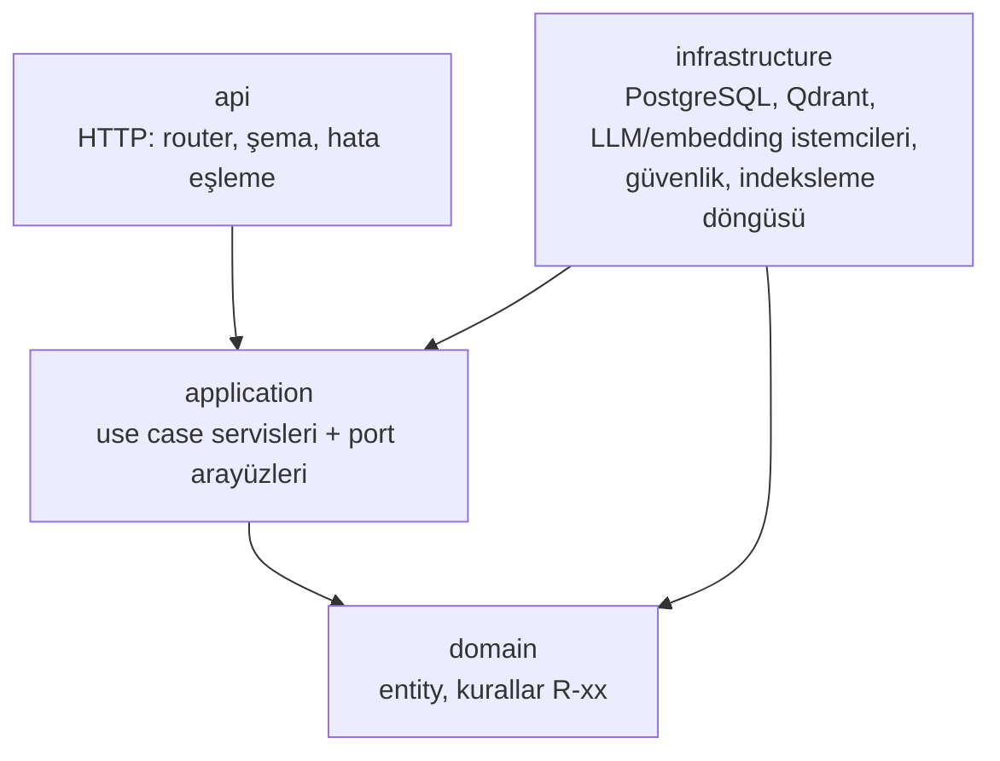

# Mimari Seçimi — Araştırma ve Karar

> Bu doküman "Hangi yazılım mimarisini seçmeliyiz ve neden?" sorusunun araştırmasıdır. Kısa karar kaydı: [ADR-001](adr/ADR-001-katmanli-mimari.md). Uygulanmış hali: [architecture.md](architecture.md).

---

## 0. Kısa cevap

**Seçimimiz: Katmanlı Mimari + Bağımlılığın Tersine Çevrilmesi (port/adapter) — tek parça çalışan bir uygulama (modüler monolit).**

Bu, hocanın **ProjectRouter** örneğindeki yapının aynısıdır (`Domain ← Application ← Data / Web`) ve Clean Architecture'ın **bağımlılık kuralını**, gereksiz törenine girmeden uygular.

Neden?
1. Ders tablosunda (Richards & Ford) **basitlik ve maliyette en iyi** stil katmanlı mimari; bizim ölçeğimizde ölçeklenebilirliğe ihtiyaç yok.
2. Katmanlı mimarinin zayıf yanı olan **test edilebilirliği**, dış servisleri (LLM, embedding, Qdrant, PostgreSQL) arayüzlerin arkasına koyarak kapatıyoruz.
3. **3 kişi, ~4 hafta, kodun çoğu yapay zeka ile yazılacak** → az kavram, net kurallar, otomatik denetim gerekiyor.
4. "Mimari uyum" kriterini **import-linter** ile otomatik ve kanıtlanabilir hale getirebiliyoruz.

---

## 1. Ders bu kriterde ne istiyor?

Ders rehberi: *"**Mimari Uyum:** Projenin seçilen ve planlanan mimariye ne kadar uyduğu göz önünde bulundurulur."*

Buradan çıkardığımız sonuç: Puanı getiren şey mimarinin "gösterişli" olması değil, **seçilmiş, belgelenmiş ve koda tutarlı uygulanmış** olması. Bu yüzden mimarimiz:

| Şart | Bizde karşılığı |
| --- | --- |
| Adı konmuş olmalı | "Katmanlı mimari + port/adapter, modüler monolit" |
| Planlanmış ve belgelenmiş olmalı | Bu doküman, [architecture.md](architecture.md), ADR'ler |
| Kodda uygulanmış olmalı | Klasör yapısı = katmanlar |
| Uyum gösterilebilmeli | import-linter CI kontrolü, review kontrol listesi |

> Karmaşık ama yer yer çiğnenen bir mimari, basit ama tutarlı uygulanan bir mimariden daha kötü görünür. Yapay zeka ajanları kuralı bilmezse kısayol kullanır (ör. router içinden doğrudan veritabanına gitmek). Bu yüzden kuralın **makine tarafından denetlenmesi** önemli.

## 2. İki seviyede karar

| Seviye | Soru | Örnekler |
| --- | --- | --- |
| **Sistem mimarisi stili** | Uygulama kaç parçadan oluşuyor, parçalar nasıl haberleşiyor, nasıl dağıtılıyor? | Katmanlı monolit, mikroservis, event-driven, service-based … (Bölüm 7) |
| **Uygulama içi yapı** | Kod içeride nasıl bölünüyor, bağımlılıklar hangi yöne akıyor? | N-katman, Clean Architecture, Hexagonal, Vertical Slice … |

## 3. Kararı belirleyen girdiler (bizim bağlamımız)

| Girdi | Durum | Mimariye etkisi |
| --- | --- | --- |
| Ekip | 3 kişi | Az kavram, herkesin hızla öğrenebileceği yapı |
| Süre | Bugün 13 Kasım; kod dondurma **13 Aralık** (~4 hafta), teslim 25 Aralık | Tören (boilerplate) minimum |
| Kod üretimi | Çoğunlukla yapay zeka ajanlarıyla | Net, yazılı, otomatik denetlenen kurallar |
| Trafik | Ders projesi, birkaç kullanıcı | Ölçeklenebilirlik/elastikiyet önemsiz |
| Dış bağımlılıklar | Bulut LLM ve embedding API'leri, Qdrant, PostgreSQL | Testte bunları **taklit edebilmek** şart |
| Asenkron iş | Sayfaların arka planda indekslenmesi | Bir arka plan döngüsü yeterli; mesaj kuyruğu gerekmiyor |
| Sunum | "Koda ne kadar hakim olunduğu sorgulanacak" | Herkesin baştan sona anlatabileceği yapı |
| Not kriterleri | Mimari uyum, test edilebilirlik, okunabilirlik, Sonar A | Test edilebilirlik ve denetlenebilirlik öncelikli |

---

## 4. Seviye 1 — Sistem mimarisi stili

Dersteki Richards & Ford tablosundaki 8 stilin bizim için değerlendirmesi:

| Stil | Ne demek? | Bizim için | Sonuç |
| --- | --- | --- | --- |
| **Layered** (katmanlı) | Tek uygulama, teknik katmanlara bölünmüş | Basitlik ★★★★★, maliyet ★★★★★. Test ★★ ama port/adapter ile düzeltilebilir | ✅ **Seçildi** |
| **Pipeline** | Veri sırayla filtrelerden geçer | Tüm uygulama için uygun değil; ama indeksleme hattımız (parçala → embed → kaydet) içeride bu fikri kullanıyor | ➖ İç desen olarak |
| **Microkernel** | Çekirdek + eklentiler (IDE, tarayıcı gibi) | Eklenti ihtiyacımız yok | ❌ |
| **Service-Based** | Birkaç büyük servis, çoğu zaman ortak veritabanı | En ciddi alternatif (test ★★★★, basitlik ★★★). Ama 2–3 ayrı deploy, servisler arası HTTP, ortak kimlik doğrulama → 4 haftada ek yük; tek ekip için kazancı yok | ❌ |
| **Event-Driven** | Bileşenler olaylar ve broker üzerinden asenkron haberleşir | Basitlik ★. Tek asenkron işimiz (indeksleme) için broker gereksiz | ❌ |
| **Space-Based** | Bellek içi veri ızgarası, çok yüksek ölçek | Gereksiz | ❌ |
| **Service-Oriented (SOA)** | Kurumsal servis veriyolu ile orkestrasyon | Kurumsal ölçek | ❌ |
| **Microservices** | Bağımsız dağıtılan küçük servisler | Basitlik ★, maliyet ★. Bölüm 8: "gereksiz karmaşıklık borcu" | ❌ |

Tablodan bize önemli satırlar:

| Özellik | Layered | Service Based | Event Driven | Microservices |
| --- | --- | --- | --- | --- |
| Simplicity | ★★★★★ | ★★★ | ★ | ★ |
| Overall Cost | ★★★★★ | ★★★★ | ★★★ | ★ |
| Testability | ★★ | ★★★★ | ★★ | ★★★★ |
| Scalability | ★ | ★★★ | ★★★★★ | ★★★★★ |

Martin Fowler'ın **"Monolith First"** önerisi de aynı yönde: Yeni bir projeye dağıtık mimariyle başlamak yerine iyi bölünmüş bir monolitle başlanır, ihtiyaç kanıtlanırsa parçalanır.

---

## 5. Seviye 2 — Uygulama içi yapı

### Adaylar

| # | Yapı | Nasıl? | Artı | Eksi |
| --- | --- | --- | --- | --- |
| **A** | **Klasik N-katman** (hocanın lesson05 BookApp örneği) | `Application → Data → Domain`; repository arayüzü Data katmanında | En basit | Application somut veri katmanına bağlı; LLM/Qdrant'ı testte taklit etmek zor |
| **B** | **Katmanlı + port/adapter** (hocanın **ProjectRouter** örneği) | `Domain ← Application (arayüzler burada) ← Infrastructure / API` | Test edilebilir, az kavram, hocanın en güncel örneğiyle aynı | Domain nesnesi ↔ veritabanı satırı eşleme kodu |
| **C** | **Clean Architecture (tam hali)** (Uncle Bob; hocanın lesson01 CvApp'i bu adı kullanıyor) | Entity, her use case için ayrı interactor sınıfı, input/output port, presenter, gateway | Çok test edilebilir | Özellik başına çok dosya ve kavram → 4 haftada aşırı mühendislik; ajanlar çok boilerplate üretir |
| **D** | **Hexagonal / Ports & Adapters** (Cockburn; hocanın HexagonalArchitecture_101 reposu) | Uygulama çekirdeği + sürücü/sürülen port'lar + adaptörler | Dış servisler için çok uygun | Terminoloji ağır; çekirdeğin içi kendiliğinden katmanlı değil. **B zaten bu fikrin "sürülen" (driven) tarafını kullanıyor** |
| **E** | **Vertical Slice** (Jimmy Bogard) | Kod özelliğe göre dilimlenir, her dilim kendi yığınını taşır | Özellik bazlı iş bölümüne uygun, az çakışma | Katman sınırı yok → "mimari uyumu" göstermek zor; ajanlarla kod tekrarı riski; hocanın örneklerinde yok |
| **F** | **Düz FastAPI** (router + model, "tutorial" tarzı) | İş mantığı router içinde | En hızlı başlangıç | Test edilemez, gösterilecek mimari yok |

### Puanlama (1–5, ekibin değerlendirmesi)

| Ölçüt | A | **B** | C | D | E | F |
| --- | --- | --- | --- | --- | --- | --- |
| Basitlik | 5 | 4 | 2 | 3 | 4 | 5 |
| Test edilebilirlik | 2 | 5 | 5 | 5 | 4 | 1 |
| Uyumun kanıtlanabilirliği | 4 | 5 | 5 | 4 | 2 | 1 |
| Ekip içi paralel çalışma | 3 | 4 | 3 | 4 | 5 | 2 |
| Yapay zeka ajanlarıyla uyum (net kural, az boilerplate) | 4 | 5 | 2 | 3 | 3 | 3 |
| Hocanın örnekleriyle uyum | 4 | 5 | 4 | 4 | 2 | 1 |
| ~4 haftaya uygunluk | 5 | 5 | 2 | 3 | 4 | 4 |
| **Toplam (/35)** | 27 | **33** | 23 | 26 | 24 | 17 |

---

## 6. Karar: B — Katmanlı mimari + port/adapter, modüler monolit



| Katman | Sorumluluk | Bağımlı olabileceği |
| --- | --- | --- |
| `domain` | `User`, `Page`, `PageContent`, kurallar (R-01 … R-13) | Hiçbir şey (sadece Python standart kütüphanesi) |
| `application` | Servisler (`PageService`, `SearchService`, `ChatService`, `IndexingService` …) ve **port arayüzleri** (`PageRepository`, `VectorIndex`, `EmbeddingProvider`, `ChatModel` …) | `domain` |
| `infrastructure` | Port'ların gerçek uygulamaları | `application`, `domain` |
| `api` | FastAPI router'ları ve şemaları | `application`, `domain` |
| `main.py` | Her şeyin birbirine bağlandığı tek yer (composition root) | Hepsi |

**Sunumda kullanılacak ad:** *"Katmanlı mimari; Clean Architecture'ın bağımlılık kuralı ve port/adapter yaklaşımıyla — modüler monolit."*

### Bilinçli olarak YAPMADIKLARIMIZ (aşırı mühendislikten kaçınma)

- Her use case için ayrı sınıf, presenter, input/output port **yok**; bir özellik = bir servis sınıfı.
- Katman başına ayrı DTO zinciri **yok**: Pydantic şemaları sadece `api`'de, iç katmanlarda sade `dataclass`'lar.
- CQRS, Mediator, generic repository, olay veriyolu (event bus) **yok**.
- Ayrı çalışan bir işçi servisi **yok**: İndeksleme döngüsü aynı süreçte çalışır (ADR-005).
- Mikroservis veya mesaj kuyruğu **yok**.

### Frontend yapısı

Özellik bazlı klasörler (`features/auth`, `features/pages`, `features/search`, `features/chat` …) + tek bir tipli API istemcisi (`src/api/`). Bileşenler `fetch` çağırmaz, API istemcisini kullanır.

## 7. Uyumu nasıl kanıtlayacağız?

1. **import-linter** (CI'da zorunlu). `backend/pyproject.toml` içine:

```toml
[tool.importlinter]
root_package = "kovan"
include_external_packages = true

[[tool.importlinter.contracts]]
name = "API katmanı application ve domain üzerine kurulu"
type = "layers"
layers = ["kovan.api", "kovan.application", "kovan.domain"]

[[tool.importlinter.contracts]]
name = "Infrastructure application ve domain üzerine kurulu"
type = "layers"
layers = ["kovan.infrastructure", "kovan.application", "kovan.domain"]

[[tool.importlinter.contracts]]
name = "API, infrastructure'ı doğrudan kullanamaz"
type = "forbidden"
source_modules = ["kovan.api"]
forbidden_modules = ["kovan.infrastructure"]

[[tool.importlinter.contracts]]
name = "İç katmanlar framework ve dış kütüphanelerden bağımsız"
type = "forbidden"
source_modules = ["kovan.domain", "kovan.application"]
forbidden_modules = ["fastapi", "pydantic", "sqlalchemy", "qdrant_client", "openai", "anthropic"]
```

2. **Review kontrol listesi:** "Yeni kod doğru katmanda mı? Router'da iş kuralı var mı?"
3. **Testler:** Servis testleri fake port'larla çalışır. Bu, bağımlılığın gerçekten tersine çevrildiğinin canlı kanıtıdır.
4. **Sunumda gösterilecekler:** Bu diyagram, `lint-imports` çıktısı ve fake'lerle çalışan bir servis testi.

## 8. Bu karar ne zaman değişir?

| Durum | Yapılacak |
| --- | --- |
| İndeksleme yükü API'yi yavaşlatırsa | İndeksleme döngüsü ayrı bir sürece taşınır (kod zaten port'larla ayrık, değişiklik `main.py` seviyesinde) |
| Çok sayıda kullanıcı ve arama yükü | Arama ayrı bir servise ayrılabilir (service-based'e geçiş) |
| Ders projesi kapsamında | **Değişmez** |

## 9. Kaynaklar

- Ders: [Bölüm 07 — Yazılım Mimarileri](https://github.com/buraksenyurt/ai-based-development-lecture/blob/main/chapter-07.md) (Richards & Ford, *Fundamentals of Software Architecture* tablosu), [Bölüm 08 — Dağıtık Sistemler](https://github.com/buraksenyurt/ai-based-development-lecture/blob/main/chapter-08.md)
- Hocanın örnekleri: `apps/ProjectRouter` (katmanlı + port), `apps/lesson05` (3 katman + ADR), `apps/lesson01` (Clean Architecture), [HexagonalArchitecture_101](https://github.com/buraksenyurt/HexagonalArchitecture_101)
- Martin Fowler — [Monolith First](https://martinfowler.com/bliki/MonolithFirst.html)
- Robert C. Martin — [The Clean Architecture](https://blog.cleancoder.com/uncle-bob/2012/08/13/the-clean-architecture.html)
- Alistair Cockburn — [Hexagonal Architecture](https://alistair.cockburn.us/hexagonal-architecture/)
- Jimmy Bogard — [Vertical Slice Architecture](https://www.jimmybogard.com/vertical-slice-architecture/)
- [import-linter dokümantasyonu](https://import-linter.readthedocs.io/)
